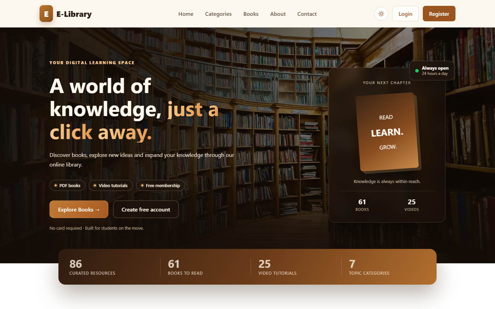
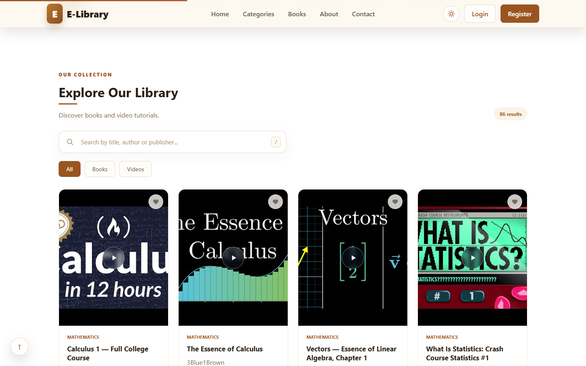
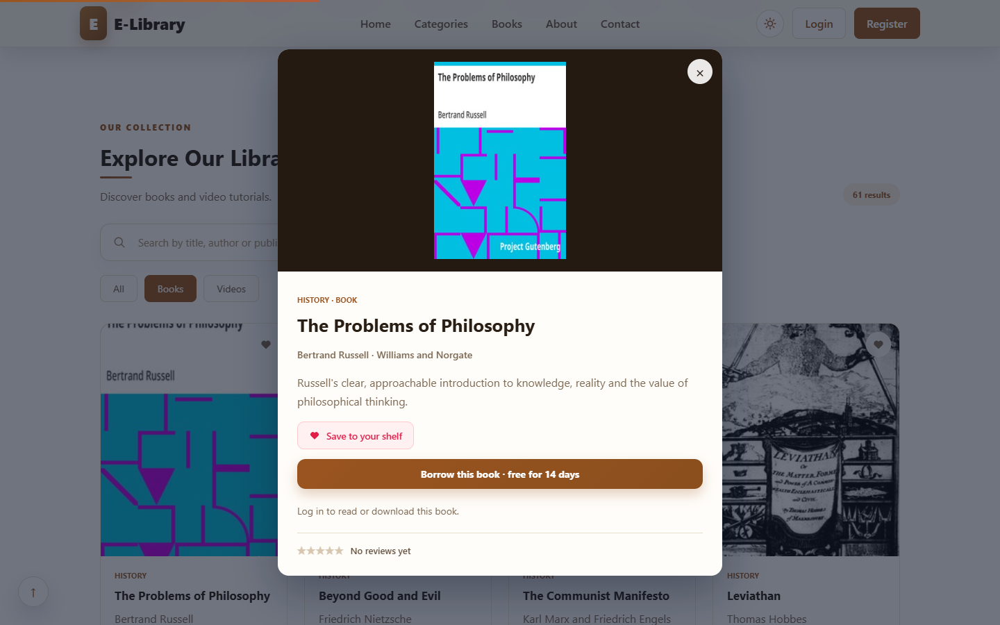
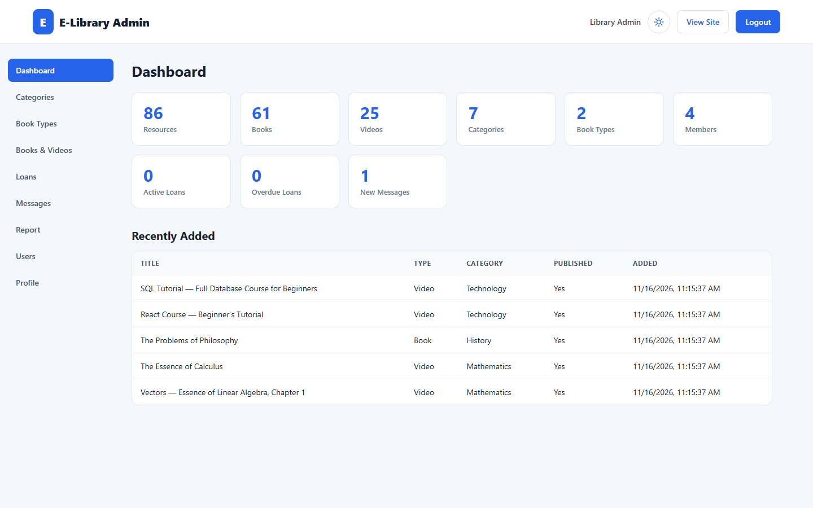
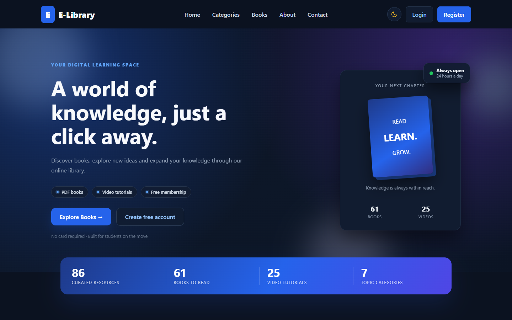

# E-Library

**A full-stack digital library** — browse 86 books and video tutorials, borrow
titles, rate and review them, keep a personal shelf, and manage the whole
catalogue from an admin dashboard. The React frontend is served by the Flask
backend, so the entire site runs from a single server.


## Screenshots

The landing page sits on a real library photograph, and the cream-and-umber
palette used across both light and dark themes is sampled from it.

| Landing page | Catalogue |
| --- | --- |
|  |  |

| Book detail — borrow, read, review | Admin dashboard |
| --- | --- |
|  |  |

| Dark mode | Mobile |
| --- | --- |
|  |  |

## Features

- **Catalogue** — 61 public-domain books and 25 curated video tutorials across 7
  categories, with search, type/category filters, live stats and paged loading
  ("Show more" / "Show all") so the first paint stays fast.
- **Motion & polish** — scroll progress, hero spotlight, word-by-word headline
  reveal, 3D card tilt with glare, ripples, staggered filters, page transitions,
  full light/dark themes and `prefers-reduced-motion` support.
- **Borrowing** — 14-day loans, a limit of 5 active loans per member, overdue
  tracking, one-click returns and a full loan history (*My Loans*).
- **Ratings & reviews** — 1–5 star reviews, one per member per resource, editable
  and deletable, with the average and count shown on each resource.
- **Personal shelf** — save favourites and revisit them any time (*My Shelf*).
- **Reading & downloads** — read books in the browser or download them
  (member-only, governed by per-category and per-book permissions).
- **Accounts** — register, log in, change password and edit your profile.
- **Admin dashboard** — manage resources, categories, book types, users and
  roles, loans and contact messages, plus category reports.
- **Contact form** — messages land in the admin inbox.
- **Polished UI** — warm library palette sampled from the hero photograph,
  responsive navbar (hamburger drawer + member dropdown on small screens) and a
  light/dark theme toggle.

## Tech stack

| Layer     | Technology                                                        |
| --------- | ----------------------------------------------------------------- |
| Frontend  | React 19, Vite 8, oxlint                                           |
| Backend   | Flask 3, Flask-SQLAlchemy, SQLAlchemy 2, PyMySQL                     |
| Database  | MySQL 8.x (SQLite for tests)                                       |
| Auth      | Server-side session cookies (roles: `member`, `admin`)             |
| Content   | Project Gutenberg PDFs, YouTube tutorials, pypdf content audit     |
| Testing   | pytest + Flask test client (22 API tests)                          |
| Packaging | Multi-stage Docker build, Docker Compose, Gunicorn                 |
| CI        | GitHub Actions (frontend lint + build, backend pytest)             |

## Architecture

In production Flask serves the built React app (`frontend/dist`) and the JSON API
from the same origin on port **5000**. Because the frontend and API share an
origin, session cookies work without extra CORS configuration. Uploaded media
(book PDFs, covers, videos) is streamed from `backend/uploads` via
`/api/media/<path>`.

In development the Vite dev server (port **5173**) proxies `/api` to Flask on
port 5000 (see `frontend/vite.config.js`), so you can hot-reload the UI while
using the real backend.

```
Browser ──► Flask (:5000) ──► MySQL
              │
              ├─ /api/*        JSON API (auth, library, loans, reviews, admin…)
              ├─ /api/media/*  uploaded books / covers / videos
              └─ /*            built React SPA (frontend/dist)
```

## Quick start — Docker (recommended)

Requires Docker with the Compose plugin. This brings up MySQL and the app,
creates the schema and seeds the demo catalogue automatically.

```bash
docker compose up --build
```

Then open **http://localhost:5000**.

- The first boot waits for MySQL's healthcheck, then runs the idempotent
  `seed_library.py` before starting Gunicorn.
- Book files already present in `backend/uploads` are baked into the image, so
  the demo is readable out of the box.
- Data persists in the named volume `db_data`. Stop with `docker compose down`
  (add `-v` to also delete the database volume).

The Compose defaults are for local demonstration only. Override them with
environment variables or a root `.env` file for anything real:

```bash
DB_PASSWORD='a-strong-password' \
MYSQL_ROOT_PASSWORD='another-strong-password' \
APP_SECRET_KEY="$(openssl rand -hex 32)" \
docker compose up --build
```

## Deploy a live demo (Railway)

The repo ships a `railway.toml`, the entrypoint honours the platform's `PORT`,
and the seed step retries until a separately provisioned MySQL is reachable.

1. On [Railway](https://railway.com) create a project and choose
   **Deploy from GitHub repo → `zeemy777/e-library`**.
2. In the same project add **New → Database → MySQL**.
3. On the app service add these variables (Railway resolves the references):

   | Variable         | Value                      |
   | ---------------- | -------------------------- |
   | `DB_HOST`        | `${{MySQL.MYSQLHOST}}`     |
   | `DB_PORT`        | `${{MySQL.MYSQLPORT}}`     |
   | `DB_NAME`        | `${{MySQL.MYSQLDATABASE}}` |
   | `DB_USER`        | `${{MySQL.MYSQLUSER}}`     |
   | `DB_PASSWORD`    | `${{MySQL.MYSQLPASSWORD}}` |
   | `APP_SECRET_KEY` | long random hex            |

4. Under **Settings → Networking** generate a public domain and open it. The
   first boot seeds the catalogue, so the demo accounts above work immediately.

Book files are baked into the image, so nothing else is needed for a demo.
Runtime uploads live inside the container and reset on redeploy; mount a volume
at `/app/backend/uploads` only if you need them to persist — an empty volume
hides the bundled demo files until `tools/build_library_assets.py` and
`seed_library.py` are run again.

Render works the same way (Docker web service plus an external MySQL such as
Aiven); Railway can host app and database in one project, so it needs fewer
steps.

## Quick start — Windows one-click

If you already have a `.venv` and a built frontend, double-click
**`Start E-Library.vbs`**. It starts the Flask server, waits for the health
check, warns you if MySQL is down, and opens http://127.0.0.1:5000/. Use
**`Stop E-Library.bat`** to stop it. MySQL (e.g. XAMPP/WAMP) must be running.

From the repository root you can also use:

```bash
npm start        # Flask on :5000 (API + built frontend)
npm run dev      # Flask + Vite dev server together
npm test         # backend pytest suite
npm run build    # production frontend bundle
```

## Manual local setup

### 1. Database

Create a database and user in MySQL 8.x:

```sql
CREATE DATABASE e_library CHARACTER SET utf8mb4 COLLATE utf8mb4_unicode_ci;
CREATE USER 'elibrary_app'@'localhost' IDENTIFIED BY 'change-me';
GRANT ALL PRIVILEGES ON e_library.* TO 'elibrary_app'@'localhost';
FLUSH PRIVILEGES;
```

### 2. Backend

```bash
cd backend
python -m venv ../.venv
# Windows: ../.venv/Scripts/activate   |   macOS/Linux: source ../.venv/bin/activate
pip install -r requirements.txt
cp .env.example .env        # then edit .env with your real values
```

Verify the connection, create the schema and seed the demo catalogue:

```bash
python test_db.py           # optional: confirms MySQL is reachable
python seed_library.py      # creates tables + seeds users, categories, catalogue
```

`seed_library.py` is safe to re-run. `init_db.py` creates the schema only, without
demo data.

Optional — (re)fetch the real, openly licensed book files, covers and videos into
`backend/uploads` (needs network access and Chrome/Edge for PDF typesetting):

```bash
python tools/build_library_assets.py
python seed_library.py      # link any newly downloaded files
```

Start the backend (serves the API and the built frontend on port 5000):

```bash
python run.py
```

### 3. Frontend

Build the production bundle that Flask serves:

```bash
cd frontend
npm ci
npm run build
```

Or run the hot-reloading dev server (proxies `/api` to the backend on :5000):

```bash
npm run dev                 # opens http://localhost:5173
```

## Environment variables

Backend configuration comes from `backend/.env` (see `backend/.env.example`).
Real process environment variables take precedence over the file, which is how
the Docker Compose values are injected.

| Variable         | Purpose                                  | Example                |
| ---------------- | ---------------------------------------- | ---------------------- |
| `DB_HOST`        | MySQL host                               | `localhost`            |
| `DB_PORT`        | MySQL port                               | `3306`                 |
| `DB_NAME`        | Database name                            | `e_library`            |
| `DB_USER`        | Database user                            | `elibrary_app`         |
| `DB_PASSWORD`    | Database password                        | `change-me`            |
| `APP_SECRET_KEY` | Flask session signing key                | long random hex string |
| `PORT`           | HTTP port inside the container (Docker)  | `5000` (hosts override) |

Generate a secret key with `python -c "import secrets; print(secrets.token_hex(32))"`.

> **Never commit `backend/.env`.** It is git-ignored and excluded from the Docker
> image. Only `.env.example` (placeholders) belongs in version control.

## Demo accounts

`seed_library.py` creates these accounts for demonstration:

| Role   | Email                  | Password        |
| ------ | ---------------------- | --------------- |
| Admin  | `admin@elibrary.com`   | `Admin@12345`   |
| Member | `member@elibrary.com`  | `Member@12345`  |

Change or remove these before any real deployment.

## Project structure

```
E-Library/
├─ backend/
│  ├─ run.py                  # App factory; serves API + frontend/dist
│  ├─ config.py               # Env-driven config (MySQL, secrets, paths)
│  ├─ extensions.py           # Shared SQLAlchemy instance
│  ├─ models.py               # User, Resource, Category, Loan, Review, …
│  ├─ auth.py                 # /api/auth — register, login, session
│  ├─ library.py              # /api — catalogue, media, read/download
│  ├─ loans.py                # /api/loans — borrow, return, history
│  ├─ reviews.py              # /api/resources/<id>/reviews — ratings
│  ├─ favorites.py            # /api/favorites — personal shelf
│  ├─ admin.py                # /api/admin — management + reports
│  ├─ contact.py              # /api/contact
│  ├─ library_catalogue.py    # Book/video catalogue data (61 + 25)
│  ├─ seed_library.py         # Idempotent schema + demo seed
│  ├─ init_db.py              # Schema-only bootstrap
│  ├─ test_db.py              # MySQL connectivity check
│  ├─ tests/                  # pytest suite (SQLite, 22 API tests)
│  ├─ tools/
│  │  ├─ build_library_assets.py  # Fetch covers, download/convert PDFs
│  │  └─ audit_library.py         # Verify PDFs match titles, covers exist
│  ├─ requirements.txt
│  ├─ requirements-dev.txt    # pytest + pypdf
│  ├─ .env.example
│  └─ uploads/{books,covers,videos}
├─ frontend/
│  ├─ src/
│  │  ├─ App.jsx              # Shell, responsive navbar, paging, view switching
│  │  ├─ pages/               # Login, Register, Shelf, Loans, Account, Admin, Contact
│  │  ├─ components/          # ResourceCard, ResourceModal, ThemeToggle, …
│  │  ├─ hooks/               # Scroll, tilt, ripple interactions
│  │  ├─ services/api.js      # Same-origin fetch wrapper (session cookies)
│  │  └─ assets/library-hero.jpg  # Home hero background
│  ├─ public/favicon.svg
│  ├─ index.html
│  ├─ vite.config.js          # Dev proxy /api → :5000
│  └─ package.json
├─ docs/screenshots/          # README screenshots
├─ Dockerfile                 # Multi-stage: Node build → Python + Gunicorn
├─ docker-compose.yml         # MySQL 8.4 + app, healthcheck, named volume
├─ docker-entrypoint.sh       # Wait for DB, seed, then serve on $PORT
├─ railway.toml               # Railway: Dockerfile build + /api/health check
├─ .dockerignore
├─ .github/workflows/ci.yml
├─ package.json               # Root scripts: start, dev, seed, audit, test, build
├─ Start E-Library.vbs        # Windows one-click launcher
└─ Stop E-Library.bat
```

## API overview

All endpoints are JSON under `/api` and use session-cookie auth unless noted.

| Group                        | Endpoints (examples)                                                        |
| ---------------------------- | -------------------------------------------------------------------------- |
| Health                       | `GET /api/health`, `GET /api/db-health`                                     |
| Auth                         | `POST /api/auth/register`, `POST /api/auth/login`, `GET /api/auth/me`, `POST /api/auth/logout`, `POST /api/auth/change-password` |
| Library                      | `GET /api/categories`, `GET /api/stats`, `GET /api/resources`, `GET /api/resources/<id>`, `GET /api/resources/<id>/read`, `GET /api/resources/<id>/download`, `GET /api/media/<path>` |
| Loans                        | `GET /api/loans/mine`, `POST /api/loans`, `POST /api/loans/<id>/return`       |
| Reviews                      | `GET/POST /api/resources/<id>/reviews`, `DELETE /api/resources/<id>/reviews/mine` |
| Favorites                    | `GET /api/favorites`, `POST/DELETE /api/favorites/<resource_id>`            |
| Contact                      | `POST /api/contact`                                                         |
| Admin                        | `GET /api/admin/dashboard`, resources, categories, book-types, users, loans, messages, reports |

## Continuous integration

`.github/workflows/ci.yml` runs on every push to `main`/`master` and on pull
requests, with two parallel jobs:

- **Frontend** — `npm ci`, `npm run lint` (oxlint), `npm run build` (Vite).
- **Backend** — install `requirements-dev.txt` and run the pytest suite against
  SQLite, so no database service is required.

## Testing

The API suite lives in `backend/tests` and covers health checks, paging and
filters, auth, favourites, borrowing rules, reviews, download/read permissions,
contact messages and the admin guard. It runs on an in-memory SQLite database
with a temporary upload folder, so it never touches MySQL or the real library
files.

```bash
cd backend
pip install -r requirements-dev.txt
python -m pytest -q
```

Or from the repository root: `npm test`. Expected: **22 passed**.

## Content pipeline & quality

The demo catalogue is real, openly licensed content rather than filler rows:

```bash
npm run assets   # fetch covers, download public-domain PDFs, typeset text books
npm run seed     # upsert categories, catalogue rows and demo accounts
npm run audit    # verify every file actually matches its title
```

`tools/build_library_assets.py` downloads Project Gutenberg titles, renders
public-domain texts to PDF with headless Chrome, and pairs each book with cover
art and curated YouTube tutorials (`img.youtube.com` thumbnails). Re-runs are
cheap: existing files are skipped.

`tools/audit_library.py` opens every PDF with pypdf, checks the PDF header and
trailer, requires at least five pages, and confirms the title, author and body
text match the catalogue entry. It also verifies covers exist and that videos
point at valid sources. The current catalogue of 61 books + 25 videos passes
with **0 problems** — this catches the classic "cover says one book, PDF contains
another" mistake.

## Security notes

- Keep `backend/.env` out of version control and out of the Docker image.
- Replace the demo accounts and default Compose passwords before deploying.
- Set a strong, unique `APP_SECRET_KEY` in any real environment.
- Session cookies are `HttpOnly` and `SameSite=Lax`. `SESSION_COOKIE_SECURE` is
  `False` for local HTTP; set it to `True` behind HTTPS in production.